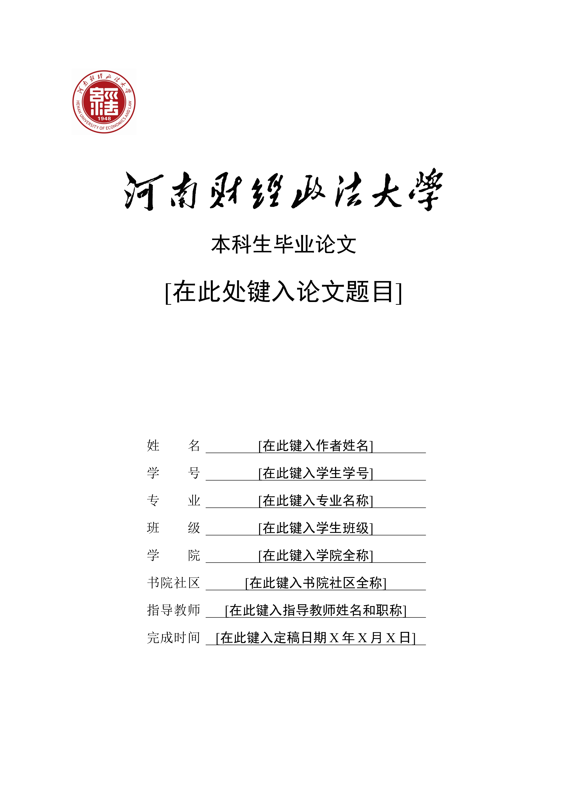

# 河南财经政法大学本科毕业论文 LaTeX 模板

依据学校毕业论文的 Word 版整理，供学习交流使用。本仓库**非官方模板**，仅是按原版重建字体、字号、页边距、段落间距和图表样式，包含封面、声明、中英文摘要、目录、正文、参考文献及致谢。

## 具体效果



可以看到此版本LaTeX编译出来的pdf版本跟word版本视觉效果几乎一致

## 文件说明

- [`LaTeX模板/main.tex`](LaTeX模板/main.tex)：论文入口，填写个人信息与论文内容；格式要求及图表、公式示例均写在源码注释中。
- [`LaTeX模板/huelthesis.sty`](LaTeX模板/huelthesis.sty)：统一控制论文版式。
- [`LaTeX模板/fonts.example.tex`](LaTeX模板/fonts.example.tex)：自定义字体配置样例。
- `word版/`：原始 Word 模板，方便对照。

## 使用方法

安装 TeX Live 或 MiKTeX，使用 **XeLaTeX** 编译。在仓库根目录执行：

```sh
cd LaTeX模板
latexmk -xelatex -interaction=nonstopmode -halt-on-error -outdir=out main.tex
```

生成的 PDF 位于 `LaTeX模板/out/main.pdf`。使用 VS Code 时，可安装 LaTeX Workshop 并配置 XeLaTeX 编译。

Mac端搭配VSCode本地配置LaTeX环境：

> 【【2026 版】 macOS 系统下配置 LaTeX + VS Code 最系统教程！逐行详细讲解 LaTeX Workshop 配置代码！】 https://www.bilibili.com/video/BV13v9yB1EMe/?share_source=copy_web&vd_source=5e3bf21f30b100235a499c6ace4c0da7

模板需要宋体、黑体、仿宋、方正小标宋简体、Times New Roman（含粗体、斜体）及 Arial，字体需自行合法安装。缺少字体或路径不匹配时，将 `fonts.example.tex` 复制为同目录下的 `fonts.tex`，填写本机字体路径。

填写时请先阅读 `main.tex` 中的注释，使用模板提供的图表与引用命令。Word 与 LaTeX 的排版、分页存在差异，提交前请检查生成的 PDF，并以所在学院最新要求为准。欢迎通过 Issues 反馈问题或提交改进。

如果本仓库帮到了你，可以点个star 🌟 :)
